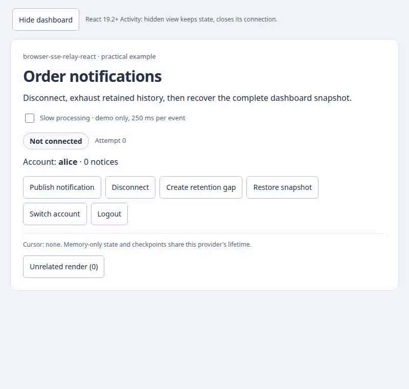
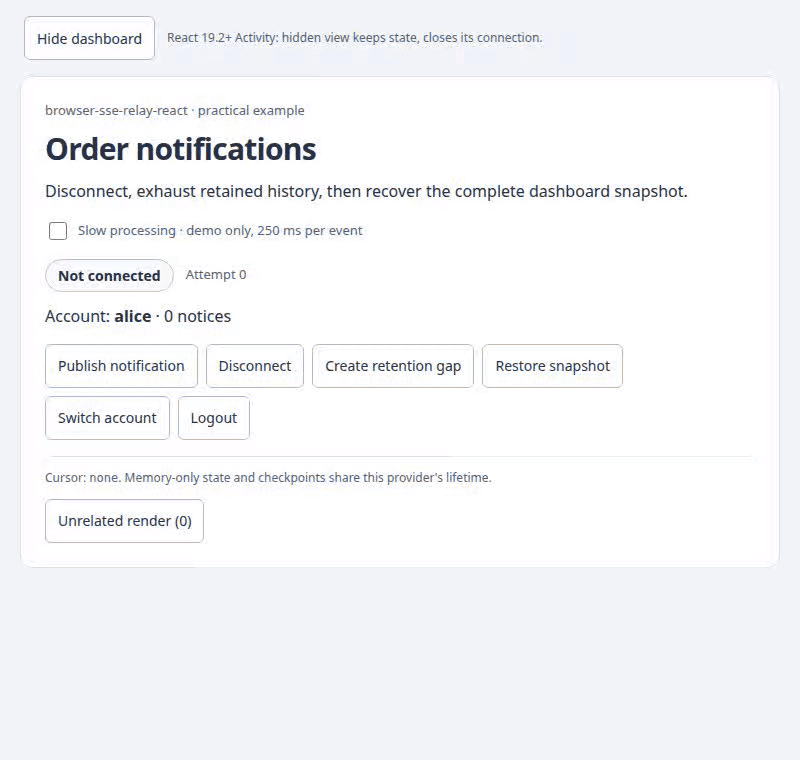

# React components in action · 0.1.0

[← Documentation](index.md) · [README](../README.md) · [Русский](visual.ru.md) · [API reference](v0.1.0/reference.en.md)

These recordings use the real React example, SseRelayClient and loopback Node reference relay. Accounts and notifications are synthetic fixtures, not production data. Protected requests use DPoP; [session setup](../examples/notifications/auth.ts) and [verifier](../examples/notifications/dpop-auth.mjs) are runnable fixtures. The UI stays in English in both guides so each recording has one reproducible source. Reduced-motion readers receive a PNG where the Markdown host supports picture media; every recording also has a direct static link.


## SseFeed: ready order notifications

The component owns the list, connection status and recovery buttons. Your module supplies only business decoding/key/render and the existing authenticated transport. [Complete module](../examples/orders/OrderNotifications.tsx) · [Project structure and walkthrough](integration.en.md).

<picture><source media="(prefers-reduced-motion: reduce)" srcset="assets/feed.png"></picture>

[Static image](assets/feed.png). The recording opens `/feed.html`, publishes an update, disconnects, pauses, expires retained history, reconnects, restores seven records and switches to an empty second account. It uses the real DPoP fixture and SseFeed; no UI state is forged. Reproduce with `npm run docs:capture:feed` from [development instructions](../CONTRIBUTING.md).

## Public API map

| Export | What you see | Integration |
|---|---|---|
| SseFeed | Ready list, connection controls and validated snapshot recovery. | [Integration](integration.en.md) |
| SseRelayProvider | Children receive one scoped connection; account switch clears the view, logout stops delivery. The provider renders no DOM of its own. | [Provider](#sserelayprovider) |
| SseConnectionStatus | Connecting, healthy, interruption/reconnect and snapshot-required feedback. | [Status](#sseconnectionstatus) |
| useSseRelay | Actions change connection state; stop/reconnect, snapshot resume and logout remain deliberate application operations. | [Actions](#usesserelay) |
| Activity — React export, 19.2+ | Hiding retains provider/view state but closes effects; showing replays the event published while hidden. | [Activity](#activity--react-192) |

These are the three lower-level connection exports; SseFeed and FeedDefaults provide the ready-list layer above. Props/value/action interfaces are types, not extra visual components. The first two are components; useSseRelay is a hook whose behavior is visible through the host's controls.

## SseRelayProvider

<picture>
  <source media="(prefers-reduced-motion: reduce)" srcset="assets/provider.png">
  
</picture>

[PNG · static / без анимации](assets/provider.png)


Alice receives one notification. Switching to Bob waits for logout, clears the view and opens a new scoped session; Bob then receives his own notification. Logout leaves an empty signed-out view and the fixture reports zero subscribers. This behavior combines provider lifecycle with the host's explicit state clearing; the provider does not erase arbitrary application state.

The complete wrapper supplies scope, endpoint, a memoized DPoP fetch and the application's awaited handler. Render ConnectionLabel and business content inside it. OAuth owns the keyPair and its bound token; getAccessToken returns that token and must be stable. Each GET/reconnect signs a fresh proof, with one nonce-challenge retry. No fixed proof/header or fallback auth scheme is used. getAccessToken should obtain a nonexpired bound token through your SDK; optional refreshAuth handles an ordinary HTTP401 through that SDK and is separate from the nonce retry.

```tsx
import { useMemo } from 'react';
import type { ReactNode } from 'react';
import { createDpopFetch } from '@59alex/browser-sse-relay';
import type { RelayOptions, StreamScope } from '@59alex/browser-sse-relay';
import { SseRelayProvider } from '@59alex/browser-sse-relay-react';

// Keep this provider and the business state for the same lifetime; the host validates and applies events.
// Provider и бизнес-состояние живут одинаково; проверку и применение событий выполняет приложение.
export function NotificationScope({ scope, keyPair, getAccessToken, origin, refreshAuth, onEvent, children }: {
  scope: StreamScope | null; keyPair: CryptoKeyPair; origin: string;
  getAccessToken: (signal: AbortSignal) => string | Promise<string>;
  refreshAuth?: RelayOptions['refreshAuth'];
  onEvent: RelayOptions['onEvent']; children: ReactNode;
}) {
  // OAuth owns this bound token/key; every GET/reconnect receives a fresh proof, never a fixed header.
  // OAuth владеет связанными token/key; каждый GET/reconnect получает новый proof, не постоянный header.
  const transport = useMemo(() => ({ fetch: createDpopFetch({ keyPair, getAccessToken, origin }),
    ...(refreshAuth ? { refreshAuth } : {}) }), [keyPair, getAccessToken, origin, refreshAuth]);
  return <SseRelayProvider scope={scope} url="/api/events" transport={transport} onEvent={onEvent}>
    {children}
  </SseRelayProvider>;
}
```

[Compiled integration source](../examples/notifications/integration.tsx) · [Recorded App and Dashboard](../examples/notifications/main.tsx) · [Actual server](../examples/notifications/server.mjs). Keep view state and the default checkpoint for the same lifetime. Null scope disables the session; it does not revoke authentication.

## SseConnectionStatus

<picture>
  <source media="(prefers-reduced-motion: reduce)" srcset="assets/recovery.png">
  
</picture>

[PNG · static / без анимации](assets/recovery.png)


The recording publishes a notice, disconnects the real HTTP stream and reconnects. Next, six events are appended while the client is stopped, exceeding the fixture's three-event retention: the UI reports Snapshot required. Restore snapshot installs seven notices with their matching cursor, then returns to live. These seven notices come from the server snapshot; they are not a claim that expired events can be replayed.

This complete component changes text, while the library supplies role=status, polite announcements and data-state. Default styling belongs to the application; the recording uses the demo's neutral connection CSS.

```tsx
import { SseConnectionStatus } from '@59alex/browser-sse-relay-react';

// Mount beneath NotificationScope. These labels do not alter the transport state machine.
// Разместите под NotificationScope. Подписи не меняют состояния transport.
export function ConnectionLabel() {
  return <SseConnectionStatus className="connection" labels={{
    connecting: 'Connecting…', live: 'Notifications up to date',
    waiting: 'Connection interrupted; retrying…', resync: 'Restore a snapshot to continue',
  }} />;
}
```

[Label integration source](../examples/notifications/integration.tsx) · [Recorded default-label usage](../examples/notifications/main.tsx) · [State and label reference](v0.1.0/reference.en.md#state-errors-and-accessible-status). For custom JSX, children is a render callback and takes precedence over labels. A translated label does not change retry or recovery policy.

## useSseRelay

<picture>
  <source media="(prefers-reduced-motion: reduce)" srcset="assets/recovery.png">
  
</picture>

[PNG · static / без анимации](assets/recovery.png)

The [same recovery recording](assets/recovery.gif) shows the hook-driven actions; it is shared with the status section rather than duplicated. The [provider recording](assets/provider.gif) shows logout.

```tsx
import { useState } from 'react';
import { useSseRelay } from '@59alex/browser-sse-relay-react';

// Logout clears a checkpoint; the host also clears its view and performs its own authentication logout.
// Logout очищает checkpoint; приложение также очищает представление и завершает свою auth-сессию.
export function ReconnectControls({ onSignedOut }: { onSignedOut: () => void }) {
  const relay = useSseRelay();
  const [error, setError] = useState('');
  const [busy, setBusy] = useState(false);
  const run = async (action: () => Promise<void>) => {
    if (busy) return;
    setBusy(true); setError('');
    try { await action(); } catch (failure) { setError(String(failure)); } finally { setBusy(false); }
  };
  return <>
    <p>{relay.state} · attempt {relay.attempt} · cursor {relay.cursor ?? 'none'}</p>
    <button disabled={busy || relay.pending} onClick={() => void run(() => relay.stop())}>Pause</button>
    <button disabled={busy || relay.pending || relay.state === 'resync'} onClick={() => relay.reconnect()}>Reconnect</button>
    <button disabled={busy || relay.pending} onClick={() => void run(async () => { await relay.logout(); onSignedOut(); })}>Sign out</button>
    {error && <p role="alert">{error}</p>}
  </>;
}
```

[Compiled control integration](../examples/notifications/integration.tsx) provides pause/reconnect/logout buttons with caught async errors. Mount it under NotificationScope. The host must handle errors and clear corresponding view/auth state in onSignedOut. The recorded Dashboard uses the same actions with its own button labels and domain recovery.

Snapshot recovery is application-specific. The complete recover function in [main.tsx](../examples/notifications/main.tsx) executes this sequence: await relay.stop(); fetch and validate scope/items/cursor; reject a stale response using a generation; install items; relay.resume(snapshot.cursor). Do not call resume with an arbitrary latest cursor or reconnect repeatedly to hide a resync gap. Handler effects can repeat after checkpoint failure; idempotent processing still belongs to the host.

| Action in the recording | Real API and result |
|---|---|
| Disconnect | Server closes the socket; bounded base retry reconnects. This is not the same as stop(). |
| Create retention gap | await stop(), publish fixture events, reconnect(); unavailable cursor ends in resync. |
| Restore snapshot | Install coherent state, then resume(cursor); no invented or skipped checkpoint. |
| Switch account / Logout | await logout() first; host clears its view and changes scope. |

## Activity — React 19.2+

<picture>
  <source media="(prefers-reduced-motion: reduce)" srcset="assets/activity.png">
  
</picture>

[PNG · static / без анимации](assets/activity.png)


One notice is visible before hiding. The captured server reports zero subscribers while hidden, and the script publishes a second notice through the real HTTP API. Showing the panel opens one subscription; replay adds that notice to the retained state. The empty area while hidden is Activity's actual display:none behavior, not a removed provider or fabricated offline screen.

ActivityExample in [main.tsx](../examples/notifications/main.tsx) wraps the existing App in Activity with mode visible/hidden. App owns both the provider and the notification state. [The Activity source and contract](v0.1.0/reference.en.md#optional-react-192-activity-example) explain why putting only a visual child inside the boundary would leave a provider outside it connected. The demo uses React 19.3.1. React 18 users keep the ordinary provider integration above; the library minimum remains18.3.

## Run and reproduce

Use sibling source checkouts of browser-sse-relay and browser-sse-relay-react, Node 22.12+, Playwright Chromium and ffmpeg. The packages need not be published.

```bash
npm run bootstrap
PORT=5183 npm run demo
# Stop that demo before the capture command: it owns the same reserved port.
# Остановите демо перед записью: capture использует тот же зарезервированный порт.
npm run docs:capture
```

Open the printed localhost URL manually. No desktop browser is opened by the capture. The [capture script](../scripts/capture-docs.mjs) starts its own fixture on 127.0.0.1:5183, records headless Chromium at 800×760, asserts account/count/status/subscriber behavior and closes its browser/server. It never stops unrelated processes.

For readable transient states, capture delays forwarding each SSE request by 650 ms; the visible Slow processing fixture option adds 250 ms per event. Neither changes the library's defaults or invents wire events. The demo's bounded retry delay is 700–1000ms. ffmpeg converts the actual recordings to 6 fps / 64-color GIFs, each checked below 2 MB. PNGs are real final frames. Raw WebM and assertions are in ignored output/visual-sse/; shipped assets live in docs/assets/. Timings, UUID cursors and encoded byte sizes may vary across runs.

## Reading the evidence

The captures prove these local interactions, not production durability, distributed replay, exactly-once effects or every browser. The Node relay holds history in one process. Synthetic login issues key-bound tokens; the copied demo verifier checks DPoP signatures, URL/method, token hash/binding, nonce, time and replay. Arbitrary account selection is a fixture, not OAuth identity verification. Network/retention policy, state consistency, credentials and idempotency belong to the application. A GIF has no interactive controls; use npm run demo to try the buttons. [Verification record](VERIFICATION.md).

[← Documentation](index.md) · [README](../README.md) · [Русский](visual.ru.md)
