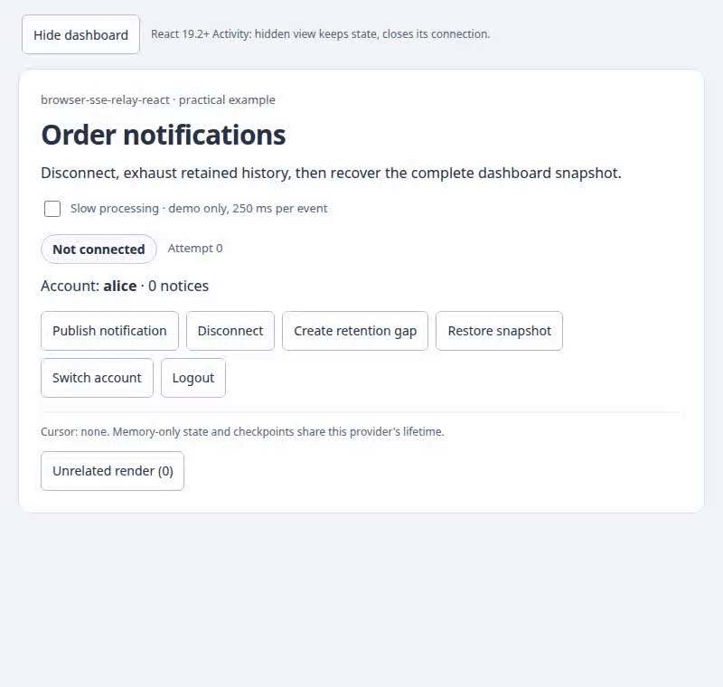
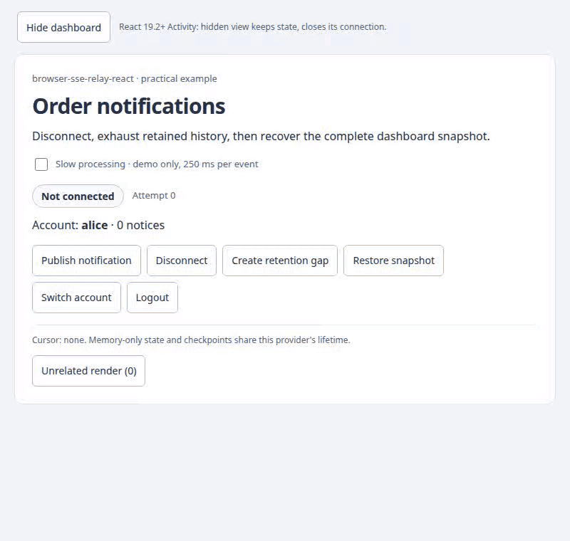

# React-компоненты в действии · 0.1.0

[← Документация](index.md) · [README](../README.md) · [English](visual.en.md) · [Справочник API](v0.1.0/reference.ru.md)

Записи показывают настоящий React-пример, SseRelayClient и локальный Node reference relay. Аккаунты и уведомления — синтетические fixture-данные, не production. Защищённые запросы используют DPoP; [создание сессии](../examples/notifications/auth.ts) и [verifier](../examples/notifications/dpop-auth.mjs) — исполняемые fixtures. UI в обеих версиях остаётся английским: у каждой записи один воспроизводимый исходник. При reduced motion используется PNG, если Markdown-host поддерживает picture media; для каждой записи есть обычная ссылка на статичный кадр.

## Карта публичного API

| Export | Что видно | Интеграция |
|---|---|---|
| SseRelayProvider | Дочерняя панель получает scoped connection; смена аккаунта очищает представление, logout останавливает доставку. Собственного DOM у provider нет. | [Provider](#sserelayprovider) |
| SseConnectionStatus | Подключение, штатная работа, обрыв/reconnect и необходимость снимка. | [Статус](#sseconnectionstatus) |
| useSseRelay | Действия меняют состояние подключения: stop/reconnect, resume снимка и logout выполняются приложением явно. | [Действия](#usesserelay) |
| Activity — export React, 19.2+ | Скрытие сохраняет provider/view state, но закрывает effects; показ воспроизводит пропущенное событие. | [Activity](#activity--react-192) |

Это все три runtime exports библиотеки. Props/value/action interfaces — типы, а не дополнительные компоненты. Первые два export — компоненты; useSseRelay — hook, его поведение видно через элементы приложения.

## SseRelayProvider

<picture>
  <source media="(prefers-reduced-motion: reduce)" srcset="assets/provider.png">
  
</picture>

[PNG · static / без анимации](assets/provider.png)


Alice получает уведомление. Переход к Bob ждёт logout, очищает представление и создаёт новую scoped-сессию; Bob получает своё уведомление. После выхода панель пуста, fixture показывает ноль подписчиков. Это совместная работа lifecycle provider и явной очистки состояния приложением; provider не удаляет произвольные бизнес-данные.

Полная обёртка задаёт scope, endpoint, мемоизированный DPoP fetch и awaited handler приложения. Разместите ConnectionLabel и бизнес-контент внутри. OAuth владеет keyPair и связанным токеном; стабильный getAccessToken возвращает этот токен. Каждый GET/reconnect подписывает новый proof, допускается один nonce retry. Постоянного proof/header или fallback-схемы нет. getAccessToken получает непросроченный bound token через ваш SDK; необязательный refreshAuth обрабатывает обычный HTTP401 через SDK отдельно от nonce retry.

```tsx
import { useMemo } from 'react';
import type { ReactNode } from 'react';
import { createDpopFetch } from '@59alex/browser-sse-relay';
import type { RelayOptions, StreamScope } from '@59alex/browser-sse-relay';
import { SseRelayProvider } from '@59alex/browser-sse-relay-react';

// Keep this provider and the business state for the same lifetime; the host validates and applies events.
// Provider и бизнес-состояние живут одинаково; проверку и применение событий выполняет приложение.
export function NotificationScope({ scope, keyPair, getAccessToken, origin, refreshAuth, onEvent, children }: {
  scope: StreamScope | null; keyPair: CryptoKeyPair; origin: string;
  getAccessToken: (signal: AbortSignal) => string | Promise<string>;
  refreshAuth?: RelayOptions['refreshAuth'];
  onEvent: RelayOptions['onEvent']; children: ReactNode;
}) {
  // OAuth owns this bound token/key; every GET/reconnect receives a fresh proof, never a fixed header.
  // OAuth владеет связанными token/key; каждый GET/reconnect получает новый proof, не постоянный header.
  const transport = useMemo(() => ({ fetch: createDpopFetch({ keyPair, getAccessToken, origin }),
    ...(refreshAuth ? { refreshAuth } : {}) }), [keyPair, getAccessToken, origin, refreshAuth]);
  return <SseRelayProvider scope={scope} url="/api/events" transport={transport} onEvent={onEvent}>
    {children}
  </SseRelayProvider>;
}
```

[Компилируемый исходник интеграции](../examples/notifications/integration.tsx) · [Записанные App и Dashboard](../examples/notifications/main.tsx) · [Настоящий сервер](../examples/notifications/server.mjs). Default checkpoint и view state должны жить одинаково. Null scope отключает сессию, но не отзывает credentials.

## SseConnectionStatus

<picture>
  <source media="(prefers-reduced-motion: reduce)" srcset="assets/recovery.png">
  
</picture>

[PNG · static / без анимации](assets/recovery.png)


Запись создаёт уведомление, обрывает HTTP-поток и переподключается. Затем во время остановки клиента сервер добавляет шесть событий, превышая retention из трёх: появляется Snapshot required. Restore snapshot устанавливает семь уведомлений и соответствующий cursor, после чего статус становится live. Эти семь элементов получены из серверного снимка, а не из уже удалённой истории.

Полный компонент ниже меняет подписи; role=status, polite announcements и data-state предоставляет библиотека. Оформление задаёт приложение; в записи используется нейтральный CSS демо.

```tsx
import { SseConnectionStatus } from '@59alex/browser-sse-relay-react';

// Mount beneath NotificationScope. These labels do not alter the transport state machine.
// Разместите под NotificationScope. Подписи не меняют состояния transport.
export function ConnectionLabel() {
  return <SseConnectionStatus className="connection" labels={{
    connecting: 'Connecting…', live: 'Notifications up to date',
    waiting: 'Connection interrupted; retrying…', resync: 'Restore a snapshot to continue',
  }} />;
}
```

[Исходник подписей](../examples/notifications/integration.tsx) · [Записанный вариант с default labels](../examples/notifications/main.tsx) · [Статусы и подписи](v0.1.0/reference.ru.md#статусы-ошибки-и-доступность). Для собственного JSX передайте children render callback: он имеет приоритет над labels. Перевод текста не меняет retry/recovery policy.

## useSseRelay

<picture>
  <source media="(prefers-reduced-motion: reduce)" srcset="assets/recovery.png">
  
</picture>

[PNG · static / без анимации](assets/recovery.png)

[Та же запись восстановления](assets/recovery.gif) показывает действия hook; файл переиспользован со статусом. [Запись provider](assets/provider.gif) показывает logout.

```tsx
import { useState } from 'react';
import { useSseRelay } from '@59alex/browser-sse-relay-react';

// Logout clears a checkpoint; the host also clears its view and performs its own authentication logout.
// Logout очищает checkpoint; приложение также очищает представление и завершает свою auth-сессию.
export function ReconnectControls({ onSignedOut }: { onSignedOut: () => void }) {
  const relay = useSseRelay();
  const [error, setError] = useState('');
  const [busy, setBusy] = useState(false);
  const run = async (action: () => Promise<void>) => {
    if (busy) return;
    setBusy(true); setError('');
    try { await action(); } catch (failure) { setError(String(failure)); } finally { setBusy(false); }
  };
  return <>
    <p>{relay.state} · attempt {relay.attempt} · cursor {relay.cursor ?? 'none'}</p>
    <button disabled={busy || relay.pending} onClick={() => void run(() => relay.stop())}>Pause</button>
    <button disabled={busy || relay.pending || relay.state === 'resync'} onClick={() => relay.reconnect()}>Reconnect</button>
    <button disabled={busy || relay.pending} onClick={() => void run(async () => { await relay.logout(); onSignedOut(); })}>Sign out</button>
    {error && <p role="alert">{error}</p>}
  </>;
}
```

[Компилируемые controls](../examples/notifications/integration.tsx) дают pause/reconnect/logout с обработкой async errors. Размещайте внутри NotificationScope. Приложение обрабатывает ошибки и очищает соответствующие view/auth state в onSignedOut. Записанный Dashboard использует те же actions со своими подписями и доменным восстановлением.

Snapshot recovery зависит от приложения. Полная функция recover в [main.tsx](../examples/notifications/main.tsx) выполняет: await relay.stop(); получение и проверку scope/items/cursor; отклонение опоздавшего ответа по generation; установку items; relay.resume(snapshot.cursor). Не передавайте произвольный latest cursor и не маскируйте resync бесконечным reconnect. Эффект handler может повториться после ошибки checkpoint: идемпотентность остаётся задачей приложения.

| Действие в записи | Настоящий API и результат |
|---|---|
| Disconnect | Сервер закрывает сокет; base retry восстанавливает соединение. Это не stop(). |
| Create retention gap | await stop(), публикация fixture-событий, reconnect(); недоступный cursor даёт resync. |
| Restore snapshot | Применение согласованного состояния, затем resume(cursor); курсор не придумывается. |
| Switch account / Logout | Сначала await logout(); приложение очищает представление и меняет scope. |

## Activity — React 19.2+

<picture>
  <source media="(prefers-reduced-motion: reduce)" srcset="assets/activity.png">
  
</picture>

[PNG · static / без анимации](assets/activity.png)


До скрытия видно одно уведомление. Во время скрытия сервер показывает ноль подписчиков, а скрипт создаёт второе уведомление настоящим HTTP-запросом. После показа существует одна подписка, replay дополняет сохранённое состояние вторым элементом. Пустое место во время скрытия — реальное display:none Activity, не удалённый provider или нарисованный offline-screen.

ActivityExample в [main.tsx](../examples/notifications/main.tsx) оборачивает App в Activity с mode visible/hidden. App владеет provider и notification state. [Исходник и контракт Activity](v0.1.0/reference.ru.md#отдельный-пример-activity-для-react-192) объясняют, почему скрытие только визуального потомка оставляет внешний provider подключённым. Демо работает на React 19.3.1. Для React 18 используйте обычный provider выше; minimum библиотеки остаётся 18.3.

## Запуск и повторная запись

Нужны соседние checkout browser-sse-relay/browser-sse-relay-react, Node 22.12+, Playwright Chromium и ffmpeg. Публикация пакетов не требуется.

```bash
npm run bootstrap
PORT=5183 npm run demo
# Stop that demo before the capture command: it owns the same reserved port.
# Остановите демо перед записью: capture использует тот же зарезервированный порт.
npm run docs:capture
```

Откройте напечатанный localhost URL вручную. Capture не открывает окно рабочего стола. [Скрипт записи](../scripts/capture-docs.mjs) запускает свой fixture на 127.0.0.1:5183, записывает headless Chromium 800×760, проверяет account/count/status/subscribers и закрывает свои browser/server. Чужие процессы не останавливаются.

Для читаемых переходов capture задерживает отправку SSE-запроса на 650мс; видимый Slow processing добавляет 250мс на событие. Defaults библиотеки и wire events не подменяются. Bounded retry демо — 700–1000мс. ffmpeg превращает настоящие записи в GIF 6 fps / 64 colors с проверкой размера меньше 2 MB. PNG — реальные последние кадры. Сырые WebM и assertions находятся в игнорируемом output/visual-sse/, итоговые assets — docs/assets/. Время, UUID курсоров и размер файла могут меняться между запусками.

## Границы доказательства

Записи подтверждают локальные действия, не production durability, distributed replay, exactly-once или все браузеры. Node relay хранит историю в одном процессе. Synthetic login выдаёт key-bound tokens; verifier проверяет DPoP-подписи, URL/method, token hash/binding, nonce, время и replay. Произвольный выбор аккаунта — fixture, не OAuth-проверка личности. Network/retention policy, согласованность состояния, credentials и идемпотентность задаёт приложение. В GIF нельзя нажимать кнопки: для этого запускайте npm run demo. [Протокол проверок](VERIFICATION.md).

[← Документация](index.md) · [README](../README.md) · [English](visual.en.md)
